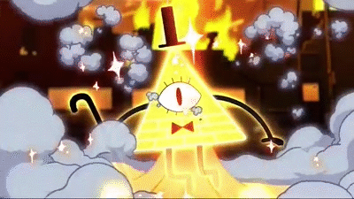
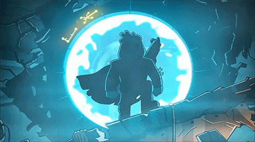
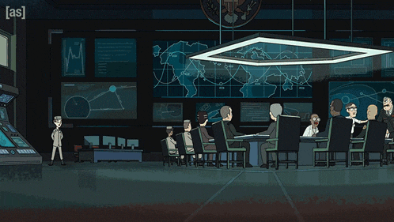

  

<h1 align="center">absurd-physics-lab</h1>

  
  
  
  

---

This repository is very different from other repositories and is of great value to me (that is, tc4dy). It is not working code or a program, but rather a proof of concept (PoC) developed using four programming languages that are deeply intertwined with and address the laws of chemistry, physics, and quantum mechanics, presented in a minimalist style that is understandable to people of all skill levels.

These projects were actually personal endeavors that I worked on in my spare time. I wanted to refine them to make them more user friendly, add more modules, and share them here. I am genuinely curious whether these peculiar laws and principles will continue to spark my interest in the future :)

The modern software world is incredibly loud. Everyone is trying to sell something. I just wanted to see the absurd rules of the universe play out in a terminal.

A lot of people see physics and chemistry as abstract stuff locked in textbooks. I always thought it was more fun to actually build the weird parts. So I took some of the strangest principles I could think of, the ones that sound like they break reality, and wrote them out in Python, C, Rust, and Shell. It is not a massive framework. Just a collection of little experiments where you can run the code and watch the logic play out.

The goal is simple. If you have ever wondered how a particle can be in two places at once, or why a program can delete itself while still running, you can just open the folder and run the script.

Here is the real kicker. Python is for reading and understanding the logic. C and Rust show you how close we can get to the metal. Shell takes you straight into the heart of the system. When you run the exact same experiment in four different languages, the physics never changes, but the soul of the code does.

Here are a few examples of what is inside, and how the theory gets turned into actual logic.

---

  

## Contents

* [Lab 1: Quantum](#lab-1-quantum)
* [Lab 2: Relativity](#lab-2-relativity)
* [Lab 3: Spacetime](#lab-3-spacetime)
* [Lab 4: Chemistry](#lab-4-chemistry)
* [Lab 5: Paradox](#lab-5-paradox)
* [How to run](#how-to-run)

---

## Lab 1: Quantum

One of the experiments deals with superposition. We hold the state as a set of probabilities. The script keeps the particle in this floating state. It only snaps to a single location when the measurement function is called. You can actually see the exact moment the math breaks down into a single reality.

Another one is quantum tunneling. The code calculates the barrier height and the particle energy. It then uses a random float to decide if the particle passes through. It matches the math of how particles slip through barriers they should not be able to cross.

---

## Lab 2: Relativity

Time dilation is a good one. If you move really fast, time for you ticks slower than for someone standing still. The code does the actual Lorentz factor math. You can see the numbers get wild as you push the velocity closer to the speed of light.

Then there is mass energy equivalence. Everyone knows E equals mc squared. We take a tiny amount of mass and multiply it by the speed of light squared. The script prints out the energy in joules. The number is so huge it almost looks like a mistake.

---

## Lab 3: Spacetime

Wormholes are tricky. We cannot actually build one. But we can model the geometry. The code calculates the shape function of a Morris Thorne wormhole. It shows how the throat connects two regions of space without a singularity. You can see the values change as you move away from the throat.

Event horizons are another one. If you fall into a black hole, an outside observer never sees you cross the line. The code calculates the Schwarzschild radius and the time dilation factor. As you get closer to the horizon, the time dilation factor drops toward zero. It shows exactly why the outside universe sees you freeze forever.

---

## Lab 4: Chemistry

Chirality is a fun one. Two molecules can have the exact same atoms, connected in the exact same way, but be mirror images of each other. One is medicine, the other can be poison. The code uses vectors to calculate the scalar triple product. A positive or negative number tells you which hand the molecule is. It is a simple geometry check, but it decides the entire chemical behavior.

Half life decay is also here. The code uses the exponential decay formula. It starts with a sample and calculates how much is left after each half life cycle. You can watch the amount drop by half every time.

---

## Lab 5: Paradox

The halting problem is a classic. The code here proves you cannot write a program that tells you if another program will finish or run forever. It sets up a paradox function. If the analyzer says the program will halt, the program loops forever. The logic contradicts itself, proving that a universal solver is impossible.

Self destructing code is another weird one. The script finds its own file path and deletes the file from the disk. But because the code is already loaded into memory, it keeps running. It breaks the normal rule that a file must exist to be executed.

---

  

## How to run

Each folder has its own README with a deeper explanation. The code is written without comments so you can read the logic directly. Just pick a language and run it. Python needs the standard library. C needs a compiler. Rust needs cargo. Shell runs in bash. No heavy dependencies, no complex setup.
